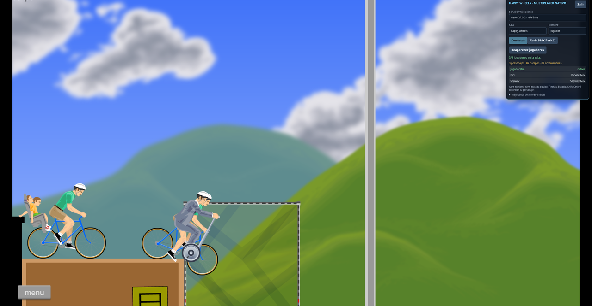
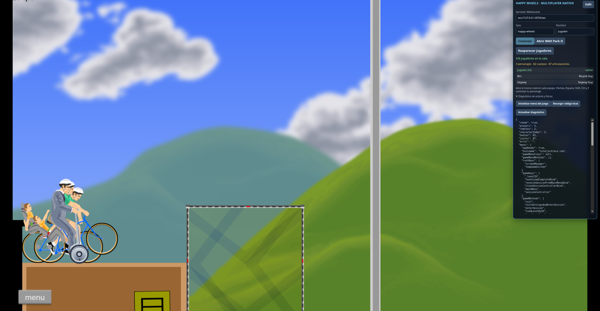
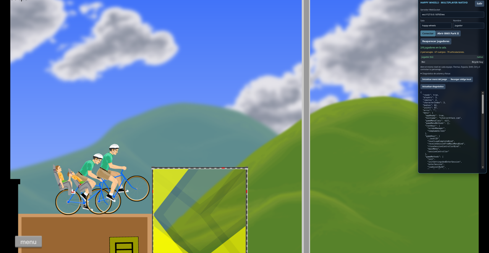

# Happy Wheels native multiplayer

This prototype relays room membership, character selection, and keyboard state
for up to eight players. The game overlay creates remote players with the
installed game's character classes, sprites, vehicles, and active Box2D world.
It does not draw screen-space substitutes.

## Screenshots

Captured on a Steam Deck in BMX Park II with two simulated players
(`npm run peer`). The local player and both remote players are native
characters in the same Box2D world.

Remote players spawn on top of the local character (after “Reaparecer
jugadores”).

When a player leaves the room, their character and all of its bodies, joints,
and sprites are removed (82 → 67 bodies).

## Start a room

1. Install the relay dependency with npm install.
2. Start the relay with npm start. Keep this terminal open.
3. In another terminal, run npm run game:launch. This makes a reversible
   backup of the installed app archive and injects the multiplayer overlay.
4. In the overlay, use the same room name on every computer. For other
   computers, change the server URL to ws://SERVER-IP:8765/ws.
5. Each player opens the same playable level in Happy Wheels. Choose a
   character in the game's normal selection screen; the room sends that
   character choice to the other clients.
6. Use the arrow keys or WASD, Space, Shift, Ctrl, and Z to control your
   character. Remote controls operate their native game vehicle.

On one PC, run npm run peer -- --name Bot --character 3 in another terminal
to add a simulated player; it replays a short key script (see the comments in
scripts/test-peer.mjs). Remote players appear on top of your character.

Expand “Diagnóstico de actores y físicas” if the game is waiting at a blank
screen; “Inicializar menú del juego” asks the game's own app controller to open
its normal menu. “Recargar código local” loads the current bridge code from the
local relay without restarting the game.

## Physics and current limits

Every player is a real game actor with its vehicle, contacts, joints, and level
collisions. Remote actors run inside the same local Box2D world as the local
player. A newly spawned player passes through the other players until their
bodies no longer touch; after that they collide normally. Each computer simulates its own copy of the world from relayed key
states; the relay does not yet send authoritative ragdoll body snapshots.
Different latency or frame timing can therefore cause positions to diverge
between computers after collisions. Use the same installed game build and the
same level on each computer.

The relay listens on all network interfaces at port 8765 by default and has no
account or encryption. Use it on a network you trust.

Keep the game:launch terminal open while playing. When Happy Wheels exits, the
launcher restores the original app.asar. If the launcher was interrupted,
close the game first and run npm run game:restore. Set HAPPY_WHEELS_DIR if the
game is installed outside the default Steam library.

Validation is manual in the installed game; no automated tests are included.
This is an unofficial prototype and is not affiliated with Fancy Force.
